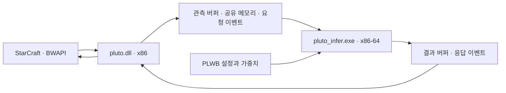

# Pluto의 신경망과 게임 연결 구조: REA 정적 분석

분석일: 2026-10-11. 대상: `tscmoo/pluto`의 `cog2026-2578600` 릴리스.
도구: REA 6.3.0, Ghidra 12.1.4, Temurin JDK 21.0.9, macOS ARM64.

## 확인한 결과

Pluto 배포물은 게임에 연결하는 32비트 DLL, 추론을 계산하는 64비트 EXE, 가중치 컨테이너로 구성된다. REA로 배포물 목록을 확인하고, Ghidra를 통해 두 실행 파일의 함수와 통신 경로를 조사했다. 가중치 파일은 별도의 바이트 파서로 검사했다.

엔진의 검사 함수는 **유닛별 연속 특성 109개, 전역 특성 292개, 행동 공간 20개, 인자 공간 233개**를 요구한다. 가중치 파일의 해당 행렬 크기와 일치한다. 추론 계산 경로에는 유닛·공간 표현, 기억 관련 처리, 행동 및 인자 출력이 나타난다.

이 결과는 신경망의 입력 표현, 가중치 행렬, 기억, 출력 분리를 설명하는 근거로 사용할 수 있다. 훈련 코드, 보상 함수, 전체 입력 필드의 의미, 실제 경기 실행은 이번 분석에서 확보하지 않았다. 학생용 교재는 이 경계를 지키면서 작은 교육용 신경망을 사용한다.

## 근거를 읽는 방법

- **정적 관찰:** 배포 파일의 바이트, REA가 반환한 문자열·참조·역컴파일 결과.
- **해석:** 정적 관찰들을 연결한 역할 설명. 실행을 관찰했다는 뜻은 아니다.
- **개발자 설명:** 공식 README가 설명하는 자기 대전, 성능, 실행 간격 등의 내용.
- **교육용 모형:** 개념을 배우기 위해 만든 숫자와 규칙. Pluto 복원 모델이 아니다.

`FUN_...` 이름은 Ghidra의 주소 기반 이름이다. 원래 소스의 함수명으로 제시하지 않는다. 역컴파일 결과의 지역 변수, 타입, 함수 경계에는 분석기의 추정이 포함된다. 아래 역할 이름은 본 보고서의 해석이다.

## 1. 분석 대상과 신원

릴리스 ZIP: `pluto-cog2026-2578600.zip`, 285,549,634바이트.
SHA-256: `d4e2225446f5048e131065357173952f0286586da77ebb8bddf7fc766c3844a5`.
다운로드한 ZIP, Ghidra ZIP, JDK 압축 파일의 SHA-256을 GitHub 릴리스 API의 digest와 대조하여 일치를 확인했다.

| 파일 | 크기(바이트) | 관찰한 형식 | 해석 |
|---|---:|---|---|
| `pluto.dll` | 465,934 | PE, x86 | BWAPI 게임 연결부 |
| `pluto/pluto_infer.exe` | 1,638,912 | PE, x86-64 | 추론 엔진 |
| `pluto/pluto_weights.bin` | 320,491,920 | `PLWB` 컨테이너 | 모델 설정·텐서 저장 |
| `README.txt` | 5,296 | 텍스트 | 배포 설명 |

REA ZIP 근거: [rea-artifact.json](evidence/rea-artifact.json), `ev_92150fe0501ed8ecae1fa51bf8b0f23245f499398e65b028080e7362587658f9`.
개별 해시: [file-manifest.json](evidence/file-manifest.json).
ZIP 내부 디렉터리 항목은 파일 개수에 포함하지 않았다.

## 2. 게임에서 신경망으로 들어가는 경로

다음은 정적 호출 관계와 공개 설명을 종합한 역할도다. 화살표는 의도된 경로에 대한 해석이며 실제 경기의 실행 추적은 아니다.

게임 연결부의 상세 근거는 [DLL 분석](dll-findings.md)에 보존했다. 주요 함수는 다음과 같다.

| 주소 | 정적으로 관찰한 내용 | 역할 해석 |
|---|---|---|
| `0x63fb5420` | `CreateFileMappingA`, `MapViewOfFile`, `CreateEventA` 두 번, `PLUTO_SHM_*` 환경 변수, `CreateProcessW` | 공유 메모리와 요청·응답 이벤트를 만들고 엔진 실행 |
| `0x63fb4bc0` | 고정 오프셋으로 배열 복사, 요청 순번 증가, `SetEvent` | 관측 제출 |
| `0x63f8baf0` | 관측 생성 → 제출 → 대기 → 결과 적용의 호출 관계 | 프레임 처리 |
| `0x63f8a9f0` | 디코더 호출, 명령 버퍼 복사, 시간·유닛 유효성 관련 처리 | 추론 결과를 게임 명령으로 연결 |

엔진의 `0x1401501f0`에서는 `PLUTO_SHM_SEC`, `PLUTO_SHM_REQ_EV`, `PLUTO_SHM_RESP_EV`, `PLUTO_SHM_PARENT`를 조회한다. `MapViewOfFile`로 메모리를 연결하고, `WaitForMultipleObjects`로 기다린 뒤 입력 배열을 복사한다. `0x140034f10`을 호출하고 결과를 저장한 뒤 `SetEvent`로 응답을 알리는 코드가 있다.

엔진 근거: [rea-022-engine-ipc-code.json](evidence/rea-022-engine-ipc-code.json), `ev_e88c1038d07c0016ea004e493300fdb46d4b73564db234e595fbf20660fa9cb4`.
읽기 편한 동일 역컴파일 문자열: [engine-ipc-code.c](evidence/rea-022-engine-ipc-code.c).
공유 메모리 연결 실패 시 파이프를 사용하는 분기도 존재한다. 따라서 배포물의 통신 가능 경로를 공유 메모리 하나로만 단정하지 않는다.

## 3. 파일에 담긴 신경망

### 가중치 컨테이너

가중치 파일 첫 16바이트에는 `PLWB`, 버전 1, JSON 헤더 길이 55,320이 있다. JSON 끝은 파일 오프셋 55,336이다. 24바이트의 0 패딩 뒤, 오프셋 55,360에서 320,436,560바이트 페이로드가 시작한다.

엔진 로더 `0x140074460`은 16바이트 헤더를 읽고 magic과 버전을 검사한다. JSON을 읽은 뒤 `(header_length + 0x4f) & ~0x3f` 위치로 이동한다. 이는 `16 + header_length`를 64바이트 경계로 올림하는 식이다. 직접 파서의 오프셋 계산과 일치한다.

근거: [rea-025-loader-code.json](evidence/rea-025-loader-code.json), `ev_9e87479af6c0ffb5191ab853476fb22c18f2697d9586c4edc434b424526fdc01`; [loader-code.c](evidence/rea-025-loader-code.c).

[inspect_weights.py](../scripts/inspect_weights.py)로 모든 선언된 텐서에 대해 형식별 바이트 수, 파일 범위, 스케일 범위, 영역 겹침을 검사했다. 오류는 0개다. 파서는 추론이나 훈련을 실행하지 않는다.

### 혼합 저장 형식

| 저장 형식 | 텐서 항목 수 | 선언된 텐서 원소 수 |
|---|---:|---:|
| int8 | 133 | 311,372,544 |
| bfloat16 | 22 | 3,312,896 |
| float32 | 114 | 354,561 |
| 합계 | 269 | 315,040,001 |

int8 항목에는 별도 `scale_offset`, `scale_len`이 있다. 스케일 배열은 위 텐서 원소 합계에 포함하지 않았다. 원소 수는 직렬화된 텐서 값의 수이며, 검증된 **학습 가능한 파라미터 수**로 바꾸어 부르지 않는다.

헤더 기본 `dtype`은 float32지만 항목별 dtype이 이를 덮어쓴다. “int8 모델”이라는 공개 설명을 모든 가중치·중간값·계산이 int8이라는 뜻으로 읽으면 안 된다.
근거: [weights-header.json](evidence/weights-header.json), [weights-summary.json](evidence/weights-summary.json).

### 모델 설정은 무엇을 말해 주는가

헤더 `model_config`에는 `d_model=768`, `d_gru=4096`, `n_layers=6`, `n_heads=12`, `slow_memory=true`, `slow_cache_size=128`, `slow_period=8` 등이 있다.

이 값은 **배포물에 저장된 설정**이다. `n_layers=6`을 모델 전체가 여섯 층이라는 뜻으로 해석하지 않는다. `slow_period=8`만으로 실행 갱신 간격을 확정하지도 않는다. 텐서에는 공간 합성곱, encoder, GRU 관련 가중치, 출력 head 등 여러 묶음이 있다.

헤더의 `source_weight_version=2578600`은 릴리스 식별과 관련된 값이다. `source_step`은 null이므로 이 숫자를 확인된 훈련 횟수로 제시하지 않는다. `source_checkpoint` 경로가 있어도 실제 훈련 체크포인트 파일을 확보한 것은 아니다.

## 4. 실제 입력과 출력 차원을 확인하기

문자열을 찾는 데서 멈추지 않고, 문자열 참조를 따라 검사 함수와 계산 코드를 조사했다.

`0x14000f1f0`은 `0x14000ed00`에 텐서 이름, 축 번호, 기대 차원, 설명을 전달한다. `0x14000ed00`은 지정된 축의 크기를 기대값과 비교하고 다르면 오류를 만든다.

| 항목 | 검사 축·기대값 | 헤더의 가중치 크기 | 확인한 의미의 범위 |
|---|---|---|---|
| `continuous_proj.0.weight` | 축 1, 109 | `[256, 109]` | 엔진이 `continuous unit features`라고 부르는 입력 차원 |
| `global_proj.0.weight` | 축 1, 292 | `[768, 292]` | 엔진이 `global features`라고 부르는 입력 차원 |
| `action_head.weight` | 축 0, 20 | `[20, 4096]` | 엔진이 요구하는 행동 출력 공간 크기 |
| `arg_head.weight` | 축 0, 233 | `[233, 768]` | 엔진이 요구하는 인자 공간 크기 |

근거: [rea-021-weight-init-code.json](evidence/rea-021-weight-init-code.json), `ev_32485ee1abe728b6b642b0819816f3e8b25a17c4bae8003cb6a09b0d14b273c7`; [검사 함수](evidence/rea-029-validator-code.json), `ev_e748a45fff7e90d44d740ee2bbfb43828d981e99c7daafb5573210dfcac0a15c`.

**해석:** `[256, 109]`은 유닛별 연속값 109개를 256개 특징으로 투영하는 행렬로 읽을 수 있다. 가중치 값은 27,904개다. 이 해석은 헤더 크기, 검사 함수의 설명, 계산 경로를 함께 근거로 한다.

**남은 질문:** 109개 값 각각의 게임 의미와 순서, 292개 전역값의 정의, 20개 행동의 전체 이름과 실행 가능 조건, 233개 인자의 매핑은 완전한 명세로 복원하지 않았다. 이 숫자는 게임 AI의 모든 입력 차원을 합친 값도 아니다.

## 5. 가중치를 사용한 계산과 기억

엔진의 `0x140034f10`은 입력 처리·모델 계산을 모으는 함수로 해석된다. 공유 메모리 처리 함수가 이를 호출한다. 함수 안에는 다음 순서의 처리 이름과 가중치 조회가 있다.

1. `encode_units`, `continuous_proj.0.weight`, `continuous_proj.0.bias`.
2. `unit_spatial_proj.weight`, `spatial_encoder`, 공간 투영.
3. `encoder`, `encoder_norm.weight`.
4. `slow_tick`, `gru_step`.
5. `action_head.weight`, 행동 조건 가중치, `arg_head.weight`, 위치·대상 관련 처리.

이 목록은 정적 코드에서 읽은 순서를 요약한 것이다. 모든 분기가 매번 실행되거나 모든 텐서가 위와 같은 단순 직렬 관계라는 뜻은 아니다.

근거: [rea-020-forward-code.json](evidence/rea-020-forward-code.json), `ev_ea4e077c5aaf51283f585b35be391f5d1e9b08b7529747510b3891657b28cb1d`; [forward-code.c](evidence/rea-020-forward-code.c).

### 손 계산과 실제 계산을 연결하는 지점

이 함수는 `continuous_proj.0.bias`와 `continuous_proj.0.weight`를 조회하여 계산 보조 함수 `0x14008dc00`에 입력과 함께 전달한다. 보조 함수에는 입력과 가중치 차원 검사, 형식별 계산 분기, 선택적인 편향 더하기가 나타난다. `action_head.weight`와 `arg_head.weight`도 선형 계산 보조 함수 `0x140018000`에 전달된다.

근거: [연속 입력 계산 보조 함수](evidence/rea-030-continuous-linear-code.json), `ev_b96a751f53656ca4550881ba8cc0d15f40699c1792063f386ddf7d272e6642a5`; [출력 계산 보조 함수](evidence/rea-026-linear-code.json), `ev_6c5d2d25885f9e53bba5ccfad2ba32b82528b255eb3adb0aef9dc48ca969bcd9`.

교재의 “입력마다 가중치를 곱하고 더한다”는 설명을 실제 가중치 행렬과 연결할 수 있다. 단, 교재에서 사용하는 ReLU, 두 입력, 공격/정찰 점수는 Pluto의 실제 해당 함수나 출력 매핑을 복원한 것이 아니다.

### 기억에 관한 근거

`gru_step` 처리에서 호출되는 `0x14002be20`은 `gru.W_i.weight`, `gru.W_i.bias`, 공간·유닛 관련 가중치들을 조회한다. 역컴파일 결과에는 이전 상태 값과 새로 계산한 값의 가중 혼합 형태가 있다. **해석:** 현재 입력뿐 아니라 이전 상태를 사용하는 기억 갱신으로 볼 수 있다.

근거: [rea-027-memory-code.json](evidence/rea-027-memory-code.json), `ev_2096042e07eccb792aa17ae818beda65c97977b109202f2f2af4c96ac4dbf072`.
GRU라는 항목명과 일부 혼합 계산을 관찰했다고 전체 모델을 표준 GRU 한 개로 규정하지 않는다. 기억 초기화, 장기 보존 능력, 실전 효과는 이번 분석에서 검증하지 않았다.

## 6. 학습과 추론을 구분하기

공식 README는 단일 신경망이 자기 대전 강화학습으로 학습되어 세 종족의 전체 게임을 수행한다고 설명한다. 이것은 **개발자 설명**이다. 이번 정적 분석은 배포된 추론 프로그램과 가중치의 구조를 조사했으며 그 훈련 이력을 독립적으로 재현하지 않았다.

README는 상대별 승패 기록으로 bandit 알고리즘이 오프닝을 선택한다고도 설명한다. 경기별 통계의 갱신을 신경망 가중치의 온라인 학습과 혼동하지 않는다. 현재 게임에서 행동을 계산하는 과정과 배포 전 가중치를 학습한 과정을 구분한다.

고정한 원문: [Pluto README 고정 원문](https://raw.githubusercontent.com/tscmoo/pluto/d41f473aeebafcfc90e28527b57324656c0ffca1/README.md), [원문 커밋 정보](evidence/pluto-source.json).

## 7. 분석 질문의 현재 상태

| 질문 | 상태 | 답 또는 남은 범위 |
|---|---|---|
| 배포물의 구성과 형식 | 확인 | ZIP 목록, 파일 크기·해시, PE 구조 |
| 게임 연결부와 엔진 통신 | 정적 경로 확인 | 공유 메모리·이벤트·프로세스 실행·파이프 분기. 실제 실행 관찰 없음 |
| 가중치 저장 형식 | 확인 | PLWB 헤더, 정렬, 혼합 dtype, 텐서 크기·범위 |
| 입력과 출력 | 부분 확인 | 109/292/20/233 검사와 가중치 대응. 전체 필드·행동 명세 미복원 |
| 모델 계산 구조 | 부분 확인 | 유닛·공간·기억·출력 경로. 전체 연산 그래프·분기 미복원 |
| 훈련 방식 | 공개 설명 확인 | 자기 대전 RL. 정확한 보상, 손실, 옵티마이저, 데이터·컴퓨트 미확보 |
| 게임 실력·예측 정확도 | 미측정 | 대전, 승률 보정, 속도·성능을 실행 검증하지 않음 |

이는 튜토리얼의 사례 분석으로 사용할 범위다. 모델 전체나 훈련의 완전한 역공학을 완료했다는 주장은 하지 않는다.

## 8. 재현과 교재 연결

- [재현 절차](REPRODUCE.md): 다운로드 식별자, 도구 준비, REA 호출, 파일 검사.
- [통합 HTML 튜토리얼](../tutorial/index.html): 그림과 조작으로 학습과 동작을 설명한다.
- [근거 색인](evidence/INDEX.md): 정확한 Evidence ID와 원본 파일 목록.

## 일차 출처

- [Pluto 저장소](https://github.com/tscmoo/pluto)와 [대상 릴리스](https://github.com/tscmoo/pluto/releases/tag/cog2026-2578600).
- [REA 6.3.0 릴리스](https://github.com/morluto/rea/releases/tag/rea-agents-6.3.0) 및 [네이티브 분석 지침](https://github.com/morluto/rea/blob/main/docs/native-investigation.md).
- [Ghidra 12.1.4 릴리스](https://github.com/NationalSecurityAgency/ghidra/releases/tag/Ghidra_12.1.4_build).
